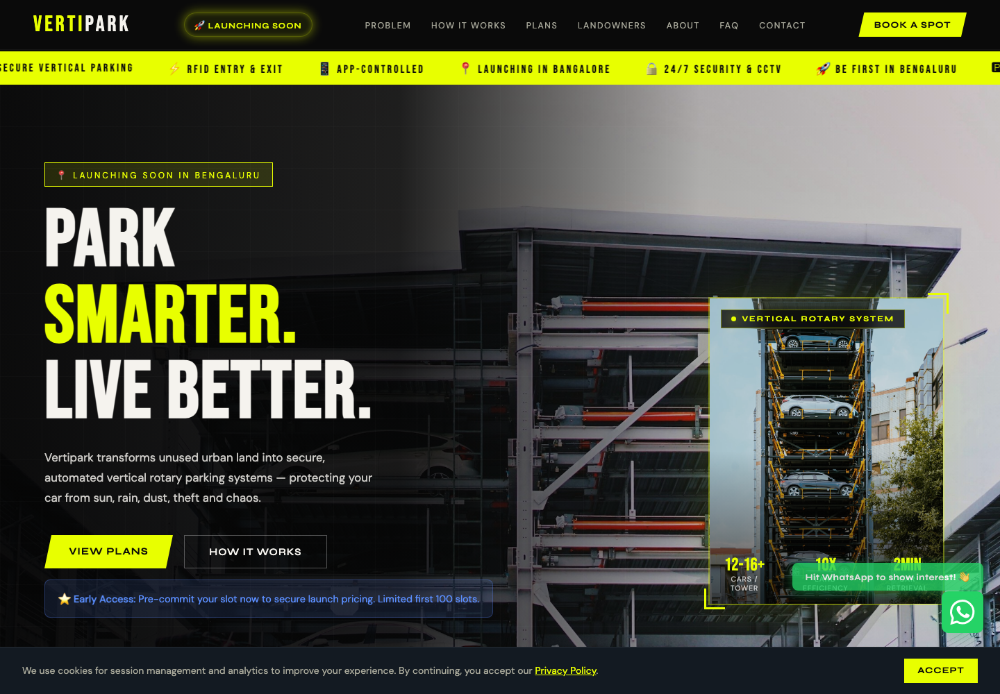

# Vertipark

Vertipark is a responsive Angular website for a Bengaluru-first vertical rotary parking service. It presents the customer parking experience, subscription plans, app controls, landowner partnership model, FAQs, contact flow, and legal information in one polished, scroll-based experience.

> **Current status:** Pre-launch — accepting early registrations and landowner enquiries in Bengaluru.



## What the platform offers

- Automated rotary towers that hold 12–16 vehicles in roughly three conventional parking spaces
- RFID-based entry and exit with app-assisted parking controls
- Enclosed, weather-protected parking with CCTV and 24/7 security messaging
- Day, weekly, monthly, quarterly, and corporate/fleet plans
- An interactive price estimator based on Bengaluru zone and plan duration
- Pickup and drop options for eligible plans
- A dedicated landowner journey covering benefits, transformation, and partnership stages
- FAQ, privacy policy, terms of service, cookie consent, and contact sections
- WhatsApp-based lead submission with a preformatted enquiry message

## Website sections

| Section | Purpose |
| --- | --- |
| Hero and system showcase | Introduces Vertipark, launch status, capacity, efficiency, and retrieval time |
| Urban parking problem | Explains weather, safety, damage, pest, and unorganised-rental pain points |
| How it works | Walks through land activation, installation, customer onboarding, and operation |
| Plans and calculator | Shows available plans and calculates indicative prices by zone and duration |
| Safety and comparison | Highlights automation, encryption, monitoring, and advantages over traditional parking |
| App preview | Demonstrates app-based access, booking, status, and vehicle controls |
| Landowners | Describes the lease proposition, benefits, before/after state, and partnership process |
| About and FAQ | Shares the company story and answers common customer and partner questions |
| Contact | Collects enquiry details and opens a populated WhatsApp message |
| Legal | Contains the privacy policy and terms of service tabs |

## Technology

| Area | Implementation |
| --- | --- |
| Framework | Angular 21 standalone components |
| Language | TypeScript 5.9 |
| UI | HTML, SCSS, Angular Material, and Angular CDK |
| State | Angular signals for navigation, consent, FAQs, and shared data |
| Routing | Angular Router with anchor scrolling and scroll restoration |
| Reactive utilities | RxJS 7.8 |
| Fonts and icons | Google Fonts and Material Icons |
| Build tooling | Angular CLI and npm |

## Getting started

### Prerequisites

- Node.js `^20.19.0`, `^22.12.0`, or `>=24.0.0`
- An LTS Node.js release is recommended; avoid odd-numbered non-LTS releases for production builds
- npm 11.x (the project records `npm@11.6.2` as its package manager)

### Install and run

```bash
git clone <repository-url>
cd Vertipark
npm install
npm start
```

Open [http://localhost:4200](http://localhost:4200). The development server reloads when source files change.

## Available commands

| Command | Description |
| --- | --- |
| `npm start` | Starts the local development server on port 4200 |
| `npm run build` | Creates an optimized production build in `dist/vertipark/browser/` |
| `npm run watch` | Builds with the development configuration and watches for changes |
| `npm test` | Runs the Angular test target |
| `npm run ng -- generate component <name>` | Generates an Angular component with the project schematics |

## Navigation and routes

The site is implemented as a single long-form landing page. These paths all render the same `Home` view and then support section-based navigation:

```text
/
/problem
/how
/plans
/app
/landowners
/about
/faq
/contact
/legal
```

Unknown paths redirect to `/`. Within the page, the navigation uses anchors such as `#plans`, `#landowners`, and `#contact`. Angular router scrolling is configured with anchor scrolling and scroll-position restoration enabled.

## Project structure

```text
Vertipark/
├── docs/
│   └── vertipark-preview.png       # README website screenshot
├── images/                         # Source marketing imagery copied by Angular
├── public/                         # Public files copied as-is at build time
│   ├── images/
│   ├── favicon.ico
│   └── vertipark-analysis.html
├── src/
│   ├── app/
│   │   ├── core/services/          # Plans, FAQ, contact, legal, pricing, and navigation data
│   │   ├── features/               # Page sections and reusable feature components
│   │   ├── shared/components/      # Navigation, ticker, and footer
│   │   ├── app.component.*         # Global shell, consent, WhatsApp, and back-to-top UI
│   │   ├── app.config.ts           # Router and scrolling providers
│   │   └── app.routes.ts           # Landing-page route aliases and fallback
│   ├── assets/images/              # Additional source image copies
│   ├── index.html                  # Metadata, fonts, icons, and Angular mount point
│   ├── main.ts                     # Application bootstrap
│   └── styles.scss                 # Global theme and shared styles
├── angular.json                    # Angular build, assets, styles, and budgets
├── netlify.toml                    # Existing static-site hosting configuration
├── package.json                    # Dependencies and npm scripts
└── tsconfig*.json                  # TypeScript configurations
```

## Implementation notes

- The active page template is `src/app/features/home/home.component.html`; it currently assembles the complete landing page in one view.
- Standalone section components also live under `src/app/features/` and shared content/data is being separated into services under `src/app/core/services/`.
- The contact form is client-side only. Submitting it formats the supplied details and opens WhatsApp; the project does not currently include a database or form API.
- Cookie acceptance is stored in the browser under `vertipark-cookies-accepted` using `localStorage`.
- The site includes a responsive navigation menu, skip link, semantic labels, back-to-top control, reduced-screen layouts, and descriptive image alternative text.
- Google Fonts and Material Icons are loaded from the network, so the visual typography and icons require internet access during normal browsing.
- Pricing shown on the website is indicative launch content and is maintained directly in the page template and the pricing/plan services.

## Assets

Angular copies both `public/` and the root `images/` directory into the build output. Website images are referenced with paths such as `images/hero-visual.jpg`, allowing the same URLs to work in development and production.

When replacing an image, keep its filename stable or update all template references. Optimize new assets before committing them to keep the initial page load small.

## Production build and deployment

Create the production bundle with:

```bash
npm run build
```

Deploy the contents of `dist/vertipark/browser/` to a static host and configure unmatched requests to fall back to `index.html` so Angular routes continue to work when opened directly.

The checked-in `netlify.toml` still targets the legacy root-level static HTML version (`vertipark-Main.html`). Update its publish directory and SPA redirect rules before using it for the Angular production bundle.

## Updating the README preview

With the development server running, capture a fresh 1440 × 1000 screenshot and replace:

```text
docs/vertipark-preview.png
```

Keep the same path so the image link at the top of this README remains valid.

## License

This project is proprietary and all rights are reserved. See [LICENSE](LICENSE) for the complete terms.
