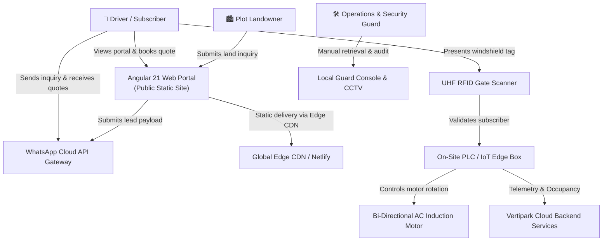
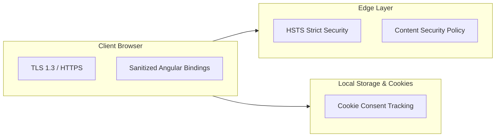

# Vertipark — System Architecture Document

---

## 1. Document Control
- **System**: Vertipark End-to-End System Architecture
- **Version**: 1.0.0
- **Status**: Active Architecture Baseline
- **Authors**: Vertipark Systems & Infrastructure Architecture Team

---

## 2. Architectural Principles & Objectives

1. **High Reliability & Zero-Downtime Operation**: Parking infrastructure is physical-critical; hardware safety interlocks must ensure vehicle safety even during network or power failures.
2. **Deterministic UI Performance**: Sub-second load times on mobile devices through pre-compiled, optimized static bundles served at edge points-of-presence (PoPs).
3. **Frictionless Omnichannel Conversion**: Instant lead capture via WhatsApp integration without requiring heavy app installs for first-time or casual visitors.
4. **Loosely Coupled Physical & Digital Domains**: The digital web/mobile tier interacts with the physical towers via an abstracted IoT gateway and edge PLC controllers.

---

## 3. High-Level System Architecture (C4 Context Diagram)



---

## 4. Frontend Application Architecture (Angular 21)

The client-facing portal is built on **Angular 21**, leveraging the newest standalone component paradigm, signals for local reactive state, and the esbuild/Vite build system.

### 4.1 Component Tree & Layering

```
src/
├── app/
│   ├── app.component.ts               # Root shell (skip-link, floating WhatsApp, back-to-top, cookie consent)
│   ├── app.component.html             # Top-level viewport container + global widgets
│   ├── app.config.ts                  # Application providers (Router, InMemoryScrolling)
│   ├── app.routes.ts                  # Declarative route configuration
│   │
│   ├── shared/
│   │   └── components/
│   │       ├── nav/                   # Sticky responsive navbar with hamburger drawer
│   │       ├── ticker/                # Infinite announcement ribbon marquee
│   │       └── footer/                # Footer columns, business metadata, legal quick-links
│   │
│   ├── features/
│   │   └── home/                      # Master landing page containing all 20 sections
│   │       ├── home.component.ts      # Event handling (Pricing calculator, FAQ accordion, WhatsApp submission)
│   │       ├── home.component.html    # Pixel-perfect semantic markup & SVG diagrams
│   │       └── home.component.scss    # Local scoped styling overrides (if needed)
│   │
│   └── core/
│       └── services/                  # Business services (Pricing, Contact, Legal, Scroll, FAQ)
│
├── assets/images/                     # High-resolution imagery (Hero, Showcase, Before/After)
├── styles.css                         # Global design system & theme variables (3,000+ lines)
└── styles.scss                        # SCSS compilation entry point
```

### 4.2 State & Reactivity Architecture
- **Angular Signals (`signal`, `computed`)**: Used for fine-grained reactivity in UI state (e.g., mobile navigation drawer open state, cookie acceptance banner visibility, back-to-top visibility based on viewport scroll thresholds).
- **DOM & Smooth Scrolling**: Native browser `Element.scrollIntoView({ behavior: 'smooth' })` enables seamless anchor traversal across long-form marketing content.
- **View Encapsulation Strategy**: `ViewEncapsulation.None` on core components ensures that global styles defined in `styles.css` directly style semantic tags, SVGs, and utility classes without scoping barriers or style duplication.

---

## 5. Styling & Visual Design System

The application utilizes a high-contrast dark theme optimized for technical clarity and brand authority.

### 5.1 Color Tokens & CSS Variables
```css
:root {
  --black:  #0a0a0a;   /* Primary dark canvas */
  --white:  #f5f3ee;   /* High-readability warm white */
  --accent: #e8ff00;   /* High-visibility electric chartreuse */
  --steel:  #1e2a38;   /* Deep metallic blue-gray for containers */
  --muted:  #a8a89a;   /* Low-contrast explanatory text */
  --card:   #131a22;   /* Elevated surface container */
}
```

### 5.2 Typography System
- **Display & Headings**: `Bebas Neue` (display uppercase) and `Syne` (weights 400, 600, 700, 800) for energetic tech-industrial branding.
- **Body & Data**: `DM Sans` (weights 300, 400, 500) for high legibility across mobile displays.

---

## 6. Physical & Mechanical IoT Architecture

```
+----------------------------------------------------------------------------------+
|                             TOWER HARDWARE SUBSYSTEM                             |
+----------------------------------------------------------------------------------+
|                                                                                  |
|   +-----------------------+     Modbus/RS485      +--------------------------+   |
|   |   Industrial PLC      | <-------------------> |   VFD Motor Controller   |   |
|   |   (Delta / Siemens)   |                       +--------------------------+   |
|   +-----------------------+                                     |                |
|               |                                                 v                |
|               | Digital I/O                        +--------------------------+  |
|               +------------------->                | 15kW Heavy-Duty AC Motor |  |
|               |                                    +--------------------------+  |
|               v                                                                  |
|   +-----------------------+   +-----------------------+   +------------------+   |
|   | Optical Vehicle Sizers|   | Mechanical Pawl Lock  |   | Emergency Stop   |   |
|   | (Length/Height Detect)|   | (Anti-Drop Interlock) |   | Circuit (Hardwire|   |
|   +-----------------------+   +-----------------------+   +------------------+   |
+----------------------------------------------------------------------------------+
```

### 6.1 Mechanical Rotary Carousel Specs
- **Capacity**: 12 to 16 passenger vehicle cages (sedans, hatchbacks, and SUVs up to 4.8m length × 2.0m width × 1.85m height).
- **Drive Mechanism**: Heavy-duty continuous roller chain driven by a high-torque 15kW reversible electric motor through a cycloidal speed reducer.
- **Cycle Time**: 2 to 4 minutes maximum rotation cycle for retrieval from the furthest vertical position.
- **Safety Interlocks**:
  - Mechanical anti-drop ratchet pawls automatically lock cages in place whenever rotation stops.
  - Optical laser curtains at ground gate prevent carousel movement if humans or obstacles are detected in the bay.
  - Slack chain sensors and over-travel limit switches trigger instant fail-safe braking.

### 6.2 RFID & Access Automation
- **UHF Long-Range Reader**: 865–867 MHz passive reader positioned at 3.5m height scanning windshield tags at a 5–8m distance.
- **Gate Barrier**: Heavy-duty automatic boom barrier with 1.2s opening time on valid validation.
- **Offline Autonomy**: Local edge controller stores a cached whitelist of authorized subscriber RFID tags; gate works even during internet interruptions.

---

## 7. Cloud, Network & Integration Architecture

### 7.1 Static Web Deployment (Netlify / CDN)
- **Host**: Netlify Global Edge Network.
- **Artifacts**: Pre-rendered and bundled JavaScript/CSS produced by `@angular/build:application`.
- **Routing**: `netlify.toml` redirects all non-file route traffic (`/*`) to `/index.html` with HTTP 200 for clean client-side routing.
- **Asset Caching**: Hashed static assets (`main-*.js`, `styles-*.css`) cached with `Cache-Control: public, max-age=31536000, immutable`.

### 7.2 Conversational Lead Engine (WhatsApp Integration)
Rather than trapping user inquiries behind complex authentication before intent is established, Vertipark uses an omnichannel WhatsApp lead pipeline:

1. User fills out contact form (name, phone, interest tier, Bengaluru locality).
2. Client-side logic constructs a URL-encoded payload formatted with Markdown styling.
3. Form triggers a new tab directing to `https://wa.me/919154246438?text=...`.
4. Vertipark's automated CRM / WhatsApp Business bot ingests the incoming inquiry, registers the lead in the backend database, and routes it to the designated area manager.

---

## 8. Security & Compliance Architecture



1. **Content Security & Transmission**:
   - TLS 1.3 enforced for all web and API communications.
   - External font assets strictly pinned to trusted Google Fonts CDNs.
2. **Data Minimization & Local Privacy**:
   - Cookie consent preferences stored locally in `localStorage` under key `vertipark-cookies-accepted`.
   - Contact form queries are user-dispatched directly to WhatsApp, minimizing preliminary server-side PII retention.
3. **Surveillance & Physical Security**:
   - 4K HD IP cameras positioned for 360° vehicle coverage.
   - On-site NVR stores encrypted recordings for 30 days before automated overwriting, complying with local surveillance guidelines.

---

## 9. Disaster Recovery & Electrical Failover

| Scenario | Failover Mechanism | Recovery Time Objective (RTO) |
| :--- | :--- | :--- |
| **Grid Power Outage** | Automatic Transfer Switch (ATS) shifts load to dedicated on-site Diesel Generator / High-capacity LiFePO4 Inverter | < 8 seconds |
| **Broadband Loss** | On-site edge gateway fails over to redundant 4G/5G cellular SIM module; local RFID whitelist maintains gate access | Immediate (0 downtime) |
| **Motor Fault** | Manual mechanical hand-crank override accessible to certified operations staff to lower any occupied cage | < 15 minutes |
| **Internet / CDN Downtime** | Multi-region Netlify fallback / secondary GitHub Pages mirror | < 1 minute |

---

## 10. Technology Stack Summary

| Layer | Technology | Purpose |
| :--- | :--- | :--- |
| **Framework** | Angular 21 | Modular, reactive client application architecture |
| **Language** | TypeScript 5.9 | Type-safe compilation and contracts |
| **Build System** | esbuild & Vite (via `@angular/build`) | Sub-second HMR and optimized production bundling |
| **Styling** | Vanilla CSS3 + SCSS | Custom property tokens, responsive CSS grid, flexbox |
| **Typography** | Google Fonts (Bebas Neue, Syne, DM Sans) | High-contrast industrial branding and readability |
| **Deployment** | Netlify Global CDN | High-availability edge delivery |
| **Edge Hardware** | Industrial PLC + Modbus VFD | Mechanical tower positioning and motor control |
| **Gate Access** | UHF RFID (865–867 MHz) | Hands-free vehicle identification |
| **Lead Gateway** | WhatsApp Cloud / Click-to-Chat API | Direct conversational lead qualification |

